<div align="center">

# Water Infrastructure Intelligence

### A deployed machine-learning application for water-point operational-status classification

<p>
  <a href="https://water-infrastructure-intelligence.streamlit.app/">Live application</a> ·
  <a href="https://water-infrastructure-intelligence.onrender.com/docs">API documentation</a> ·
  <a href="https://github.com/maryembencheikh/Water-Infrastructure-Intelligence/actions">CI pipeline</a>
</p>


[](https://github.com/maryembencheikh/Water-Infrastructure-Intelligence/actions/workflows/ci.yml)

</div>

---

## Overview

**Water Infrastructure Intelligence** is an end-to-end machine-learning application that classifies the recorded operational status of water points in Tanzania into three categories:

- `functional`
- `functional needs repair`
- `non functional`

The project turns structured information about a water point—such as its location, construction, extraction system, water quantity and quality, and management arrangements—into a model prediction and class-probability breakdown.

The selected model is a **LightGBM multiclass classifier** embedded in a scikit-learn preprocessing pipeline. The model is exposed through a **FastAPI** REST API, packaged for backend deployment with **Docker**, and consumed by a **Streamlit** user interface.

> **Scope and responsible use.** This is a data-science portfolio and decision-support prototype built on the historical DrivenData competition dataset. It classifies the status represented by the supplied record; it is **not** a time-series forecasting system, a verified field inspection, or a substitute for engineering assessment. Predictions should not be used as the sole basis for maintenance, safety, funding, or service-delivery decisions.

## Live application and services

| Component | Link | Purpose |
|---|---|---|
| Streamlit application | [Open the application](https://water-infrastructure-intelligence.streamlit.app/) | User-facing assessment form, predictions, visualizations and model insights |
| FastAPI backend | [Open the API](https://water-infrastructure-intelligence.onrender.com) | Serves the trained model through REST endpoints |
| Swagger UI | [Open interactive API docs](https://water-infrastructure-intelligence.onrender.com/docs) | Explore and test the API contract |
| ReDoc | [Open ReDoc](https://water-infrastructure-intelligence.onrender.com/redoc) | Alternative API documentation |
| GitHub Actions | [View CI runs](https://github.com/maryembencheikh/Water-Infrastructure-Intelligence/actions) | Automated backend tests and frontend syntax validation |

The frontend and backend are deployed independently. Streamlit Community Cloud hosts the interface; Render hosts the Dockerized FastAPI service. The frontend calls the backend over HTTP using JSON requests.

## Business problem

Water-point operators and local stakeholders need reliable information to understand which water points are operational, which are operating but require repair, and which are not operational. Knowing the likely status of an asset can help structure inspection and maintenance workflows and make it easier to prioritize follow-up.

This project formulates that task as **supervised multiclass classification**. Given the recorded characteristics of a water point, the model estimates one of the three operational-status labels.

The prediction is an estimate based on historical labelled data. It does not establish the physical condition of a water point today, identify the cause of a failure, or predict when a future failure will occur.

## Dataset

The project uses the **[Pump it Up: Data Mining the Water Table](https://www.drivendata.org/competitions/7/)** practice competition. The competition describes the data as originating from Taarifa and the Tanzanian Ministry of Water. Its objective is to classify water pumps as functional, requiring repairs, or non-functional.

### Dataset files

Obtain the competition files from DrivenData and place them in `data/raw/` using the original filenames:

| File | Records | Role |
|---|---:|---|
| `Training set values.csv` | 59,400 | Water-point predictors and identifier |
| `Training set labels.csv` | 59,400 | Target label (`status_group`) and identifier |
| `Test set values.csv` | 14,850 | Competition records without target labels |
| `SubmissionFormat.csv` | 14,850 | Expected competition submission structure |

After joining the labelled values and labels on `id`, the training table contains 59,400 observations. The identifier and target are excluded from the model inputs, leaving **39 predictor columns**. The competition test file contains 14,850 records and is distinct from the internal validation split used to report the metrics below.

The data includes geographic, technical, operational, water-quality, quantity, payment and management information. The exploratory analysis examines missingness, categorical cardinality, class distribution and relationships between recorded characteristics and the target.

### Target distribution

The labelled training data is imbalanced:

| Target class | Records | Share |
|---|---:|---:|
| `functional` | 32,259 | 54.31% |
| `non functional` | 22,824 | 38.42% |
| `functional needs repair` | 4,317 | 7.27% |
| **Total** | **59,400** | **100%** |

The relatively small `functional needs repair` class is an important evaluation consideration. For that reason, model selection and interpretation do not rely on accuracy alone.

> **Data availability.** The raw competition files are not stored in this repository. The root `.gitignore` excludes `data/` to avoid committing the raw dataset. Download the files from DrivenData yourself and place them in `data/raw/` when reproducing the analysis.

## Data science methodology

The work is organized into three Jupyter notebooks:

1. `notebooks/01_exploratory_data_analysis.ipynb` — data understanding, quality checks, distributions and exploratory analysis.
2. `notebooks/02_data_preprocessing.ipynb` — preprocessing exploration and preparation of modelling inputs.
3. `notebooks/03_machine_learning.ipynb` — model experiments, model selection, hold-out evaluation and SHAP analysis.

### 1. Data understanding and EDA

The exploration covers:

- Dataset dimensions and integrity after joining features and labels.
- Target-class distribution and class imbalance.
- Missing values and high-cardinality categorical variables.
- Numeric and categorical feature profiles.
- Relationships between recorded water-point characteristics and operational status.

### 2. Preprocessing and feature engineering

The deployed estimator is a fitted pipeline. Its preprocessing steps are applied consistently during training and inference.

The custom `WaterDataCleaner` transformer includes the following operations:

- Coerces selected numeric columns to numeric values, converting invalid values to missing values.
- Treats zero longitude as a missing-value sentinel and creates a `longitude_missing` indicator.
- Creates an `amount_tsh_zero` indicator and an `amount_tsh_log` transformation.
- Treats `construction_year == 0` as missing.
- Derives `recorded_year` and `recorded_month` from `date_recorded`.
- Fills selected missing categorical values with `Unknown` and removes redundant or unsuitable columns from the modelling input.

The `RareCategoryGrouper` groups infrequent values into `Other` for `ward`, `scheme_name`, `installer` and `funder` (minimum-frequency setting: 10).

A `ColumnTransformer` then applies separate transformations:

| Feature type | Pipeline |
|---|---|
| Numeric | Median imputation → `StandardScaler` |
| Categorical | Constant imputation (`Unknown`) → `OneHotEncoder(handle_unknown="ignore")` |

### 3. Model development and selection

Several candidate classifiers were compared. The tuned-model comparison recorded in the modelling notebook is:

| Model | Accuracy | Balanced accuracy | Macro F1 |
|---|---:|---:|---:|
| Random Forest | 75.24% | 73.53% | 67.28% |
| **LightGBM (selected)** | **77.53%** | 73.36% | **69.00%** |
| XGBoost | 79.44% | 63.27% | 66.13% |

LightGBM was selected because it achieved the **highest Macro F1** among these tuned candidates. XGBoost achieved a higher accuracy in this comparison, but its lower balanced accuracy and Macro F1 indicate a less even performance across the three classes. This is material given the class imbalance.

The LightGBM classifier uses `class_weight="balanced"`. Hyperparameters were searched with `RandomizedSearchCV` and a 3-fold `StratifiedKFold` strategy (`shuffle=True`, `random_state=42`).

### 4. Validation protocol

The labelled data was split using a stratified 80/20 hold-out split with `random_state=42`:

| Split | Records | Use |
|---|---:|---|
| Training partition | 47,520 | Model fitting and cross-validation-based selection |
| Hold-out validation partition | 11,880 | Final reported classification metrics |

The 14,850-row competition test file is **not** the 11,880-row hold-out validation set. It has no target labels and is not the source of the reported validation metrics.

## Model performance

The following results are from the held-out validation partition of 11,880 labelled observations.

### Overall metrics

| Metric | Result | Interpretation |
|---|---:|---|
| Accuracy | **77.53%** | Overall proportion of correct predictions |
| Balanced accuracy | **73.36%** | Mean recall across the three classes |
| Macro F1 | **69.00%** | Unweighted mean of the per-class F1 scores |
| Best cross-validation Macro F1 | **68.34%** | Best mean score recorded during 3-fold model selection |

### Per-class performance

| Actual class | Precision | Recall | F1-score | Support |
|---|---:|---:|---:|---:|
| `functional` | 0.84 | 0.79 | 0.81 | 6,452 |
| `functional needs repair` | 0.34 | 0.63 | 0.44 | 863 |
| `non functional` | 0.84 | 0.79 | 0.81 | 4,565 |

The main weakness is the `functional needs repair` class. Its **63% recall** means that the model identifies a portion of the true repair cases, while its **34% precision** means that many predictions assigned to this class are false positives. This trade-off should be considered before using the output to prioritize inspections or allocate maintenance resources.

### Confusion matrix

Rows represent the actual class; columns represent the predicted class. The order is `functional`, `functional needs repair`, `non functional`.

| Actual \ Predicted | Functional | Needs repair | Non-functional |
|---|---:|---:|---:|
| Functional | 5,079 | 773 | 600 |
| Needs repair | 222 | 541 | 100 |
| Non-functional | 717 | 257 | 3,591 |

### Selected LightGBM hyperparameters

| Hyperparameter | Selected value |
|---|---:|
| `class_weight` | `balanced` |
| `colsample_bytree` | 0.6571 |
| `learning_rate` | 0.1337 |
| `max_depth` | -1 |
| `min_child_samples` | 11 |
| `n_estimators` | 543 |
| `num_leaves` | 49 |

`max_depth = -1` means no explicit maximum depth is imposed by this parameter; tree complexity is still constrained by other LightGBM settings, including `num_leaves` and `min_child_samples`.

## Model explainability

SHAP (SHapley Additive exPlanations) was used to inspect model contributions at both global and individual-observation levels. The saved analysis uses a sample of **500 hold-out observations**. After preprocessing and one-hot encoding, the SHAP output has shape **(500, 2,936, 3)**: 500 observations, 2,936 transformed features and three class outputs.

The repository includes the extracted plots used by the Streamlit Model Insights page:

### Global and class-specific summaries

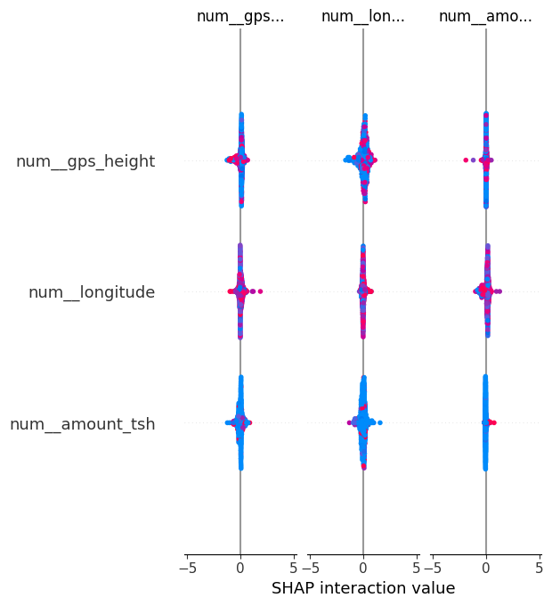

<details>
<summary>Class-specific SHAP summaries</summary>

**Functional**

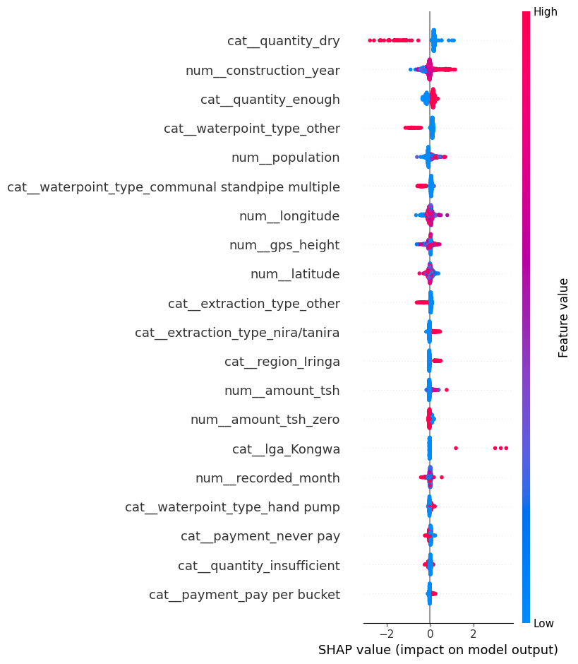

**Functional needs repair**

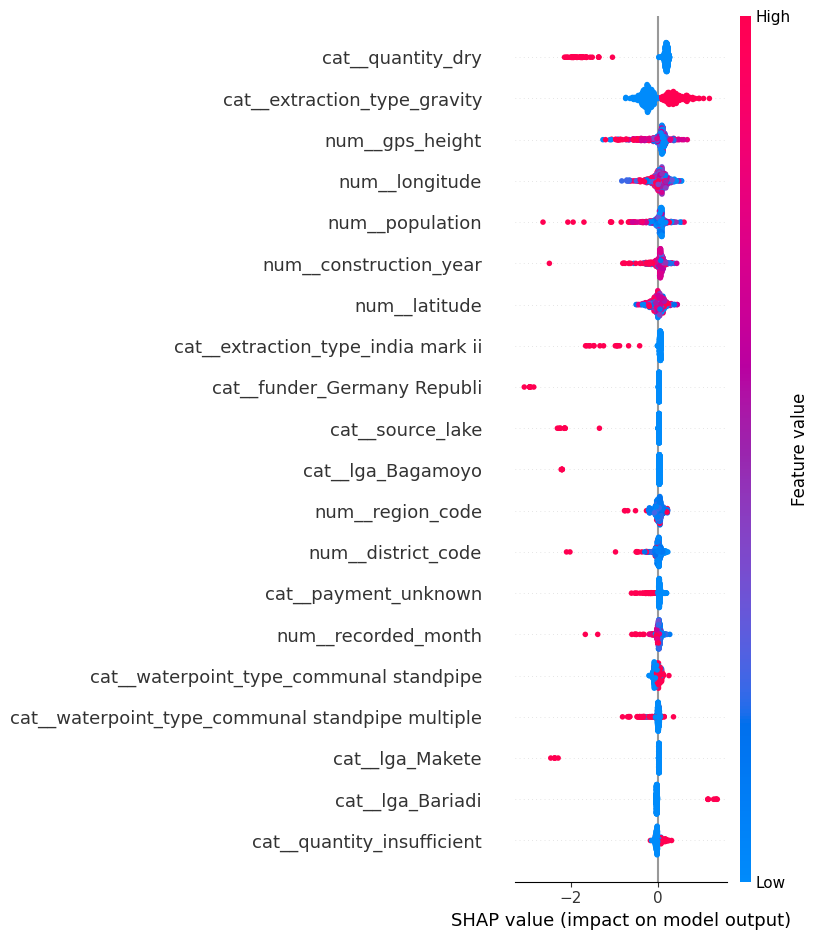

**Non functional**

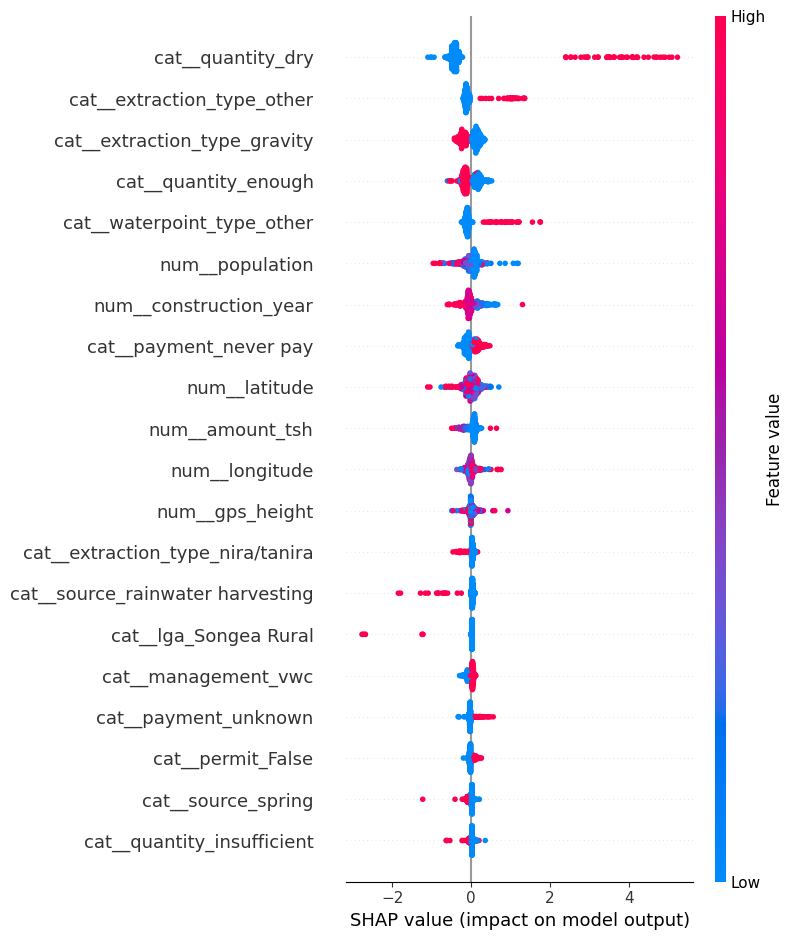

</details>

### Local explanation

The Waterfall plot below explains one recorded validation observation. In the notebook, observation 2 was predicted as `functional needs repair`, while its actual label was `functional`.

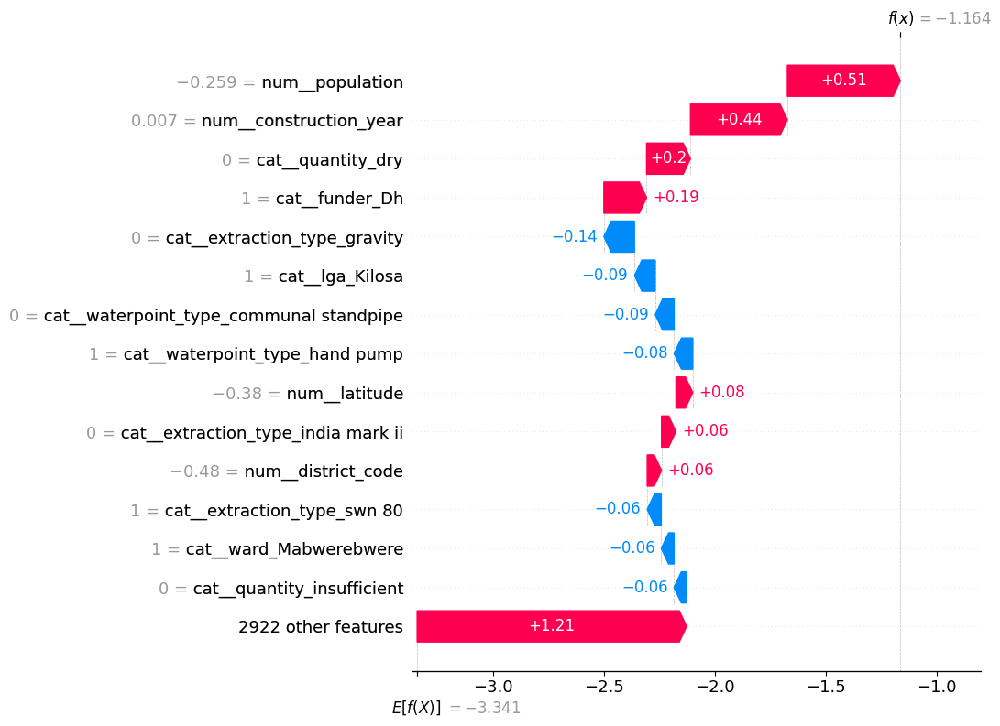

SHAP values describe how features contribute to the model output. They do **not** establish causal relationships between a feature and the real-world condition of a water point.

## Application features

The Streamlit interface is organized into five pages:

| Page | Purpose |
|---|---|
| **Overview** | Project summary, dataset indicators and platform overview |
| **Water Point Assessment** | Structured water-point input form with dataset-backed category options and dependent geographic selections |
| **Prediction Results** | Predicted class, class probabilities, visual summaries, input recap and JSON report export |
| **Model Insights** | Validation metrics, per-class performance, confusion matrix, model configuration and SHAP visualizations |
| **About the Project** | Project methodology, architecture and technical information |


## Application Screenshots

The platform provides an interactive interface organized into five main sections.

### 1. Overview

The main dashboard presents the project's objectives, dataset statistics, target distribution and platform capabilities.

<p align="center">
  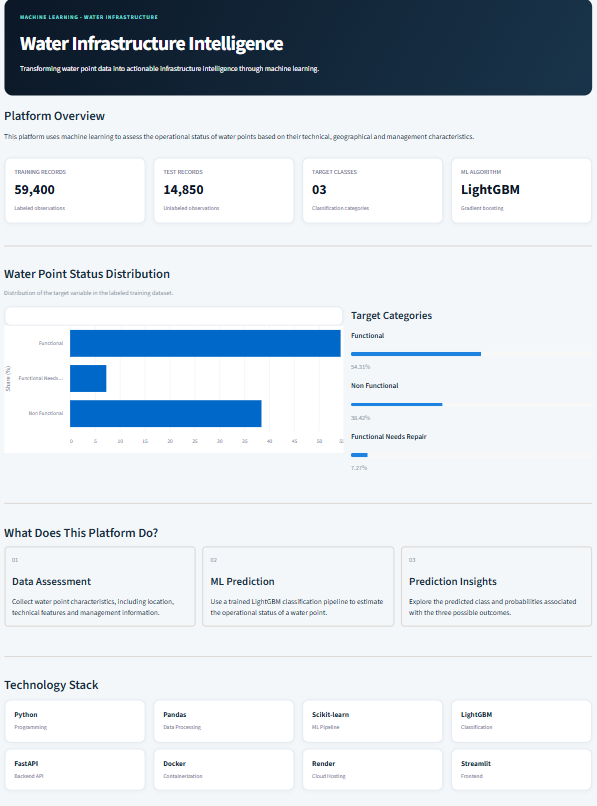
</p>

### 2. Water Point Assessment

An interactive assessment form with guided categorical inputs, geographic selections and data validation.

<p align="center">
  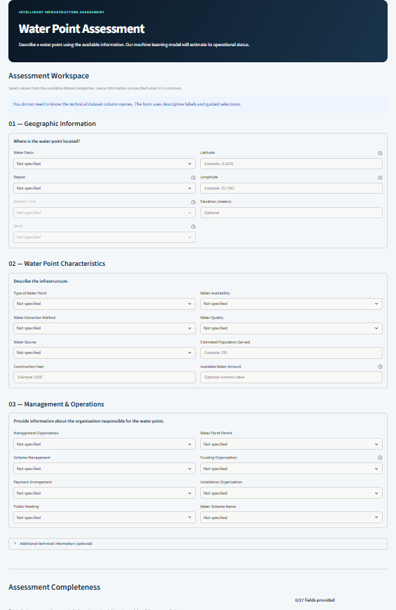
</p>

### 3. Prediction Results

Displays the predicted operational status, class probabilities, probability visualizations and submitted assessment information.

<p align="center">
  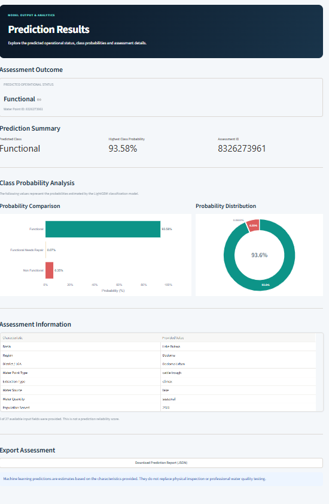
</p>

### 4. Model Insights

Presents model performance metrics, classification diagnostics, confusion matrix and SHAP-based explainability visualizations.

<p align="center">
  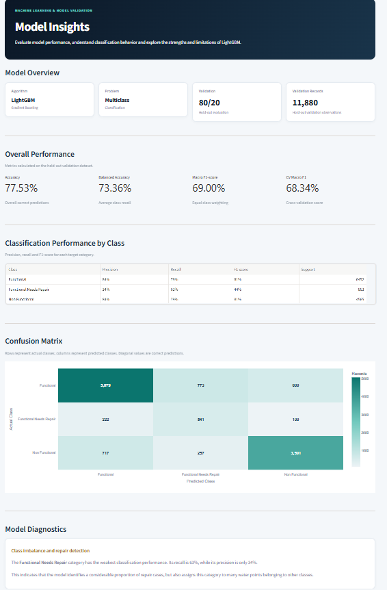
</p>

### 5. About the Project

Provides additional information about the project's objectives, methodology, technical components and architecture.

<p align="center">
  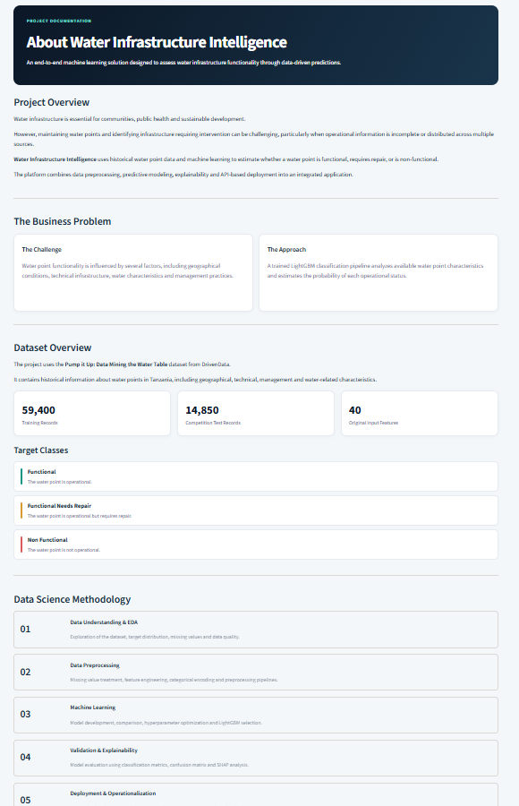
</p>

## System architecture

### Prediction flow

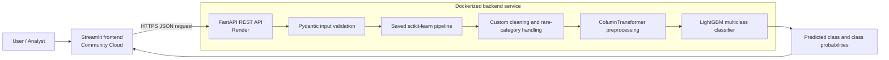

### Delivery flow

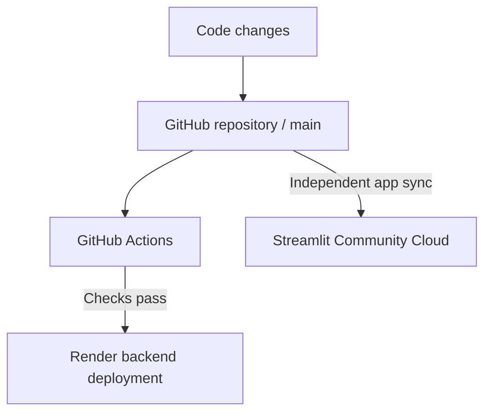

The Render service is configured to deploy after CI checks pass. Streamlit Community Cloud deploys the frontend from GitHub independently; its deployment is not gated by the Render setting.

## API reference

The public API is served by FastAPI.

| Method | Endpoint | Description |
|---|---|---|
| `GET` | `/health` | Returns API health and whether the model is loaded |
| `POST` | `/predict` | Validates a water-point record and returns a predicted class with class probabilities |
| `GET` | `/docs` | Interactive Swagger UI |
| `GET` | `/redoc` | ReDoc documentation |
| `GET` | `/openapi.json` | OpenAPI schema |

### Example request

The `id` field is required. The remaining fields in `WaterPointInput` are optional and may be supplied when available. Unknown fields are rejected by the request schema.

```http
POST /predict
Content-Type: application/json
```

```json
{
  "id": 12345,
  "amount_tsh": 0,
  "gps_height": 1200,
  "longitude": 32.9,
  "latitude": -2.5,
  "population": 250,
  "construction_year": 2005,
  "waterpoint_type": "communal standpipe",
  "source": "shallow well",
  "quantity": "enough",
  "water_quality": "soft"
}
```

### Example response

The values below are illustrative; actual predictions and probabilities depend on the submitted record.

```json
{
  "id": 12345,
  "prediction": "functional",
  "probabilities": {
    "functional": 0.75,
    "functional needs repair": 0.15,
    "non functional": 0.10
  },
  "status": "success"
}
```

## Local setup and execution

### Prerequisites

- Python 3.13
- Git
- Docker Desktop (optional, for running the backend container)
- Access to the DrivenData dataset files for reproducing the notebooks

### 1. Clone the repository

```bash
git clone https://github.com/maryembencheikh/Water-Infrastructure-Intelligence.git
cd Water-Infrastructure-Intelligence
```

### 2. Create and activate a virtual environment

**Windows PowerShell**

```powershell
py -3.13 -m venv .venv
.\.venv\Scripts\Activate.ps1
python -m pip install --upgrade pip
```

**macOS / Linux**

```bash
python3.13 -m venv .venv
source .venv/bin/activate
python -m pip install --upgrade pip
```

### 3. Install backend and frontend dependencies

```bash
python -m pip install -r requirements-api.txt
python -m pip install -r frontend/requirements.txt
```

The modelling/notebook environment is described separately in the root `requirements.txt`:

```bash
python -m pip install -r requirements.txt
```

### 4. Verify the model artifact

The backend expects the fitted pipeline at:

```text
artifacts/best_lgbm_pipeline_compatible.joblib
```

This artifact is copied into the Docker image by the root `Dockerfile`. If it is missing from a local checkout, obtain the project artifact before starting the API.

### 5. Start the FastAPI backend

From the repository root:

```bash
python -m uvicorn src.api.main:app --reload --host 127.0.0.1 --port 8000
```

Useful local endpoints:

- Health check: <http://127.0.0.1:8000/health>
- Swagger UI: <http://127.0.0.1:8000/docs>
- ReDoc: <http://127.0.0.1:8000/redoc>

### 6. Start the Streamlit frontend

Open a **second terminal**, activate the same virtual environment, and point the frontend to the local API.

**Windows PowerShell**

```powershell
$env:API_BASE_URL = "http://127.0.0.1:8000"
python -m streamlit run frontend/app.py
```

**macOS / Linux**

```bash
export API_BASE_URL="http://127.0.0.1:8000"
python -m streamlit run frontend/app.py
```

The frontend uses `API_BASE_URL` when it is set. If it is not set, the API client falls back to the deployed Render API URL.

### Optional: run the backend with Docker

From the repository root:

```bash
docker build -t water-infrastructure-intelligence-api .
docker run --rm -p 8080:8080 water-infrastructure-intelligence-api
```

The container starts Uvicorn on port `8080` by default. The Render deployment supplies its runtime `PORT` value.

## Testing and CI/CD

Automated checks are defined in [`.github/workflows/ci.yml`](.github/workflows/ci.yml) and run on pushes to `main` and pull requests targeting `main`.

| Job | Checks |
|---|---|
| **Backend API Tests** | Installs backend dependencies and test tools, then runs `pytest tests/test_api.py -v` |
| **Frontend Validation** | Installs frontend dependencies and compiles the Python files with `python -m compileall -q frontend` |

The current API test suite covers:

- `/health` returns a healthy status and confirms the model is loaded.
- `/predict` returns a valid class and probabilities that sum to approximately 1.
- Unknown request fields are rejected with HTTP 422.
- Invalid numeric input is rejected with HTTP 422.

Render is configured to deploy the backend **after CI checks pass**. Streamlit Community Cloud separately synchronizes the frontend from GitHub; that frontend deployment is not currently gated by the Render CI setting.

Run the backend tests locally with:

```bash
python -m pip install pytest==9.2.0 httpx==0.28.1
python -m pytest tests/test_api.py -v
```

Run the frontend syntax check locally with:

```bash
python -m compileall -q frontend
```

## Repository structure

```text
Water-Infrastructure-Intelligence/
├── .github/
│   └── workflows/
│       └── ci.yml                         # GitHub Actions CI workflow
├── artifacts/
│   └── best_lgbm_pipeline_compatible.joblib  # Fitted inference pipeline
├── data/
│   └── raw/                               # Local competition data (not committed)
├── frontend/
│   ├── app.py                             # Streamlit entry point
│   ├── assets/
│   │   ├── style.css                      # Global styles
│   │   └── shap/                          # Exported SHAP plots
│   ├── components/
│   │   ├── api_client.py                  # HTTP client for FastAPI
│   │   └── catalog.py                     # Category-catalog utilities
│   ├── data/
│   │   └── category_options.json          # Dataset-backed form options
│   ├── pages/
│   │   ├── 1_Overview.py
│   │   ├── 2_Assessment.py
│   │   ├── 3_Results.py
│   │   ├── 4_Model_Insights.py
│   │   └── 5_About.py
│   ├── scripts/
│   │   ├── extract_shap_plots.py
│   │   └── generate_category_options.py
│   └── requirements.txt
├── notebooks/
│   ├── 01_exploratory_data_analysis.ipynb
│   ├── 02_data_preprocessing.ipynb
│   └── 03_machine_learning.ipynb
├── src/
│   ├── api/
│   │   ├── main.py                        # FastAPI app and endpoints
│   │   └── schemas.py                     # Pydantic request/response schemas
│   └── preprocessing.py                   # Custom pipeline transformers
├── tests/
│   └── test_api.py
├── .dockerignore
├── .gitignore
├── Dockerfile
├── requirements-api.txt
└── requirements.txt
```

## Limitations and next steps

The current validation results highlight several areas that deserve care:

1. **Minority-class performance.** `functional needs repair` has 34% precision and 63% recall. Many predicted repair cases are false positives, while some true repair cases are missed.
2. **Class imbalance.** Only 7.27% of the labelled training observations belong to `functional needs repair`.
3. **Historical, cross-sectional data.** The model predicts the status label associated with a record; the current dataset and modelling setup do not establish future failure timing or causal factors.
4. **Probability interpretation.** Returned class probabilities are model outputs. Probability calibration has not been established in the reported evaluation, so they should not be interpreted as guaranteed confidence levels.
5. **Operational validation.** Field validation, temporal/geographic robustness checks and monitoring for data drift would be required before considering operational use.

Potential future work includes improving repair-class precision/recall trade-offs, probability calibration, additional robustness evaluation, monitoring and richer model diagnostics.

## References and data attribution

- [DrivenData — Pump it Up: Data Mining the Water Table](https://www.drivendata.org/competitions/7/) — competition description and dataset access.
- [DrivenData — `pump-it-up` repository](https://github.com/drivendataorg/pump-it-up) — competition context and source attribution to Taarifa and the Tanzanian Ministry of Water.

---

<div align="center">

**Water Infrastructure Intelligence**  
*An end-to-end applied machine-learning project, from data understanding to a deployed prediction interface.*

[Live application](https://water-infrastructure-intelligence.streamlit.app/) · [GitHub repository](https://github.com/maryembencheikh/Water-Infrastructure-Intelligence)

</div>
